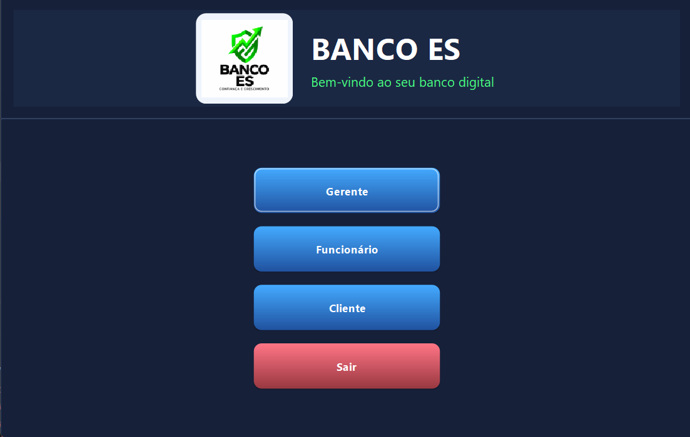
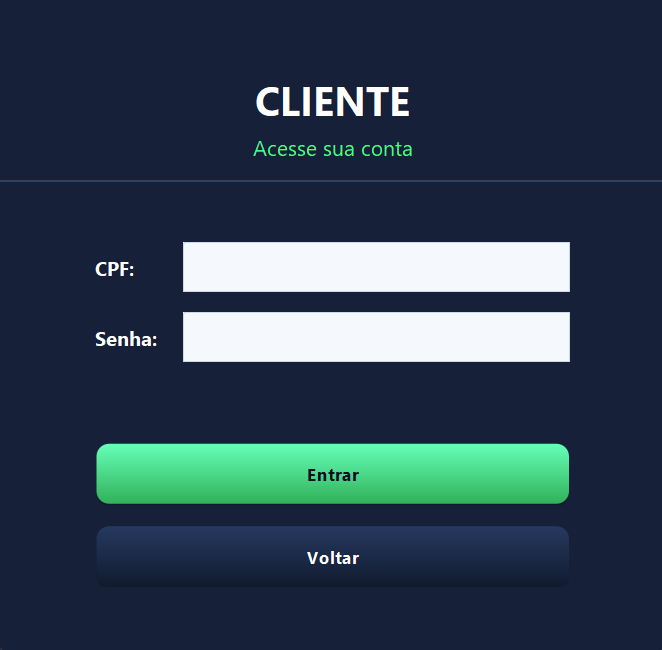
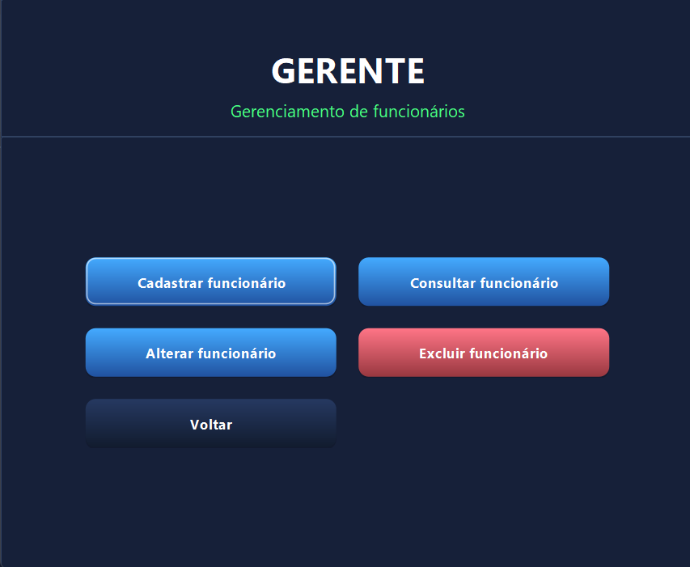
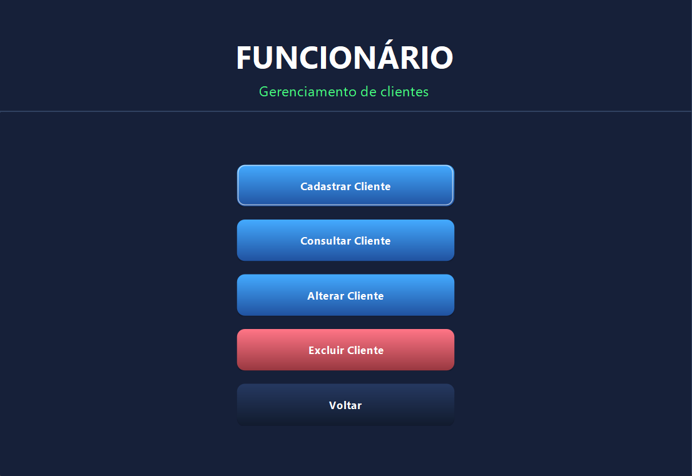

# Banco ES - Trabalho 2 (Marco 2)

Evolução do sistema bancário **Banco ES** em Java, refatorado para atender aos princípios **SOLID**, **Clean Architecture** e **Clean Code**, com **interface gráfica em Swing**, **persistência em banco de dados (SQLite via JDBC)** e **documentação JavaDoc em HTML**.

> **Nota:** A documentação original do **Marco 1** foi preservada integralmente na segunda metade deste arquivo para registro histórico e conferência do checklist inicial.

---

## 1. Integrantes e Responsabilidades (Marco 2)

| Integrante | Responsabilidade Principal | Princípios / Entregas |
|---|---|---|
| **Iasmin Dembinski da Silva** | Entidades e regras de negócio (`domain/pessoas` e `domain/contas`) | SRP, LSP, validações de domínio, `SaldoInsuficienteException`, `ContaLspTest` e JavaDoc do domínio |
| **Liane Paim De Castro Genz** | Casos de uso e regras de aplicação (`application/casodeuso` e `application/validacao`) | SRP, OCP, remoção de regras das telas, injeção de repositórios e JavaDoc |
| **Emanuel Lopes Vieira** | Interfaces, abstrações e arquitetura (`application/repositories` e estrutura de camadas) | ISP, DIP, Clean Architecture, injeção de dependências no `Main` e JavaDoc |
| **Vinícius Schaefer Sanchotene** | Banco de dados e persistência (`infrastructure/persistence`) | SQLite, JDBC, `PreparedStatement`, `script.sql`, repositórios JDBC e JavaDoc |
| **Adryan Oliveira de Oliveira** | Interface gráfica, testes de integração e documentação final (`presentation/swing`) | Identidade visual, layout, usabilidade, integração com casos de uso, prints e geração do JavaDoc HTML |

---

## 2. Arquitetura do Projeto (Clean Architecture)

O projeto foi reorganizado em camadas com dependências direcionadas ao núcleo (`domain`), permitindo que as regras de negócio funcionem de forma independente da interface gráfica e do banco de dados:

```text
Trabalho_POO/
├── lib/
│   └── sqlite-jdbc-3.54.1.0.jar
├── PrintTelas/
├── docs/                          # [PREENCHER — Adryan: pasta do JavaDoc HTML gerado]
└── src/
    ├── main/
    │   ├── Main.java              # Ponto de entrada e injeção de dependências
    │   ├── domain/                # Camada de Entidades (núcleo, sem dependências externas)
    │   │   ├── pessoas/           # Cliente, Funcionario, Gerente
    │   │   └── contas/            # Conta, ContaCorrente, ContaPoupanca, ContaConjunta, ContaPJ, TipoConta, SaldoInsuficienteException
    │   ├── application/           # Camada de Casos de Uso e Contratos
    │   │   ├── casodeuso/         # autenticacao/, cliente/, conta/, funcionario/
    │   │   ├── repositories/      # ClienteRepository, ContaRepository, FuncionarioRepository
    │   │   └── validacao/         # ValidadorCliente, ValidadorFuncionario, ValidadorValor
    │   ├── infrastructure/        # Camada de Infraestrutura (detalhes externos)
    │   │   └── persistence/       # Conexao, *RepositoryJDBC, script.sql
    │   └── presentation/          # Camada de Apresentação
    │       └── swing/             # Telas Swing e componentes visuais
    └── test/
        └── ContaLspTest.java      # Testes de Substituição de Liskov (LSP)
```

Fluxo de dependências entre camadas:

```text
Interface Gráfica (presentation/swing)
        ↓
Casos de Uso (application/casodeuso)
        ↓
Interfaces de Repositório (application/repositories)  ←──  Entidades (domain)
        ↑
Implementações JDBC (infrastructure/persistence)
        ↓
Banco de Dados SQLite
```

---

## 3. Configuração do Banco de Dados e Instruções de Execução

### Pré-requisitos
- **JDK:** Java 17 ou superior (conforme `pom.xml`)
- **Driver JDBC:** `lib/sqlite-jdbc-3.54.1.0.jar` (já incluso no repositório)
- **IDE recomendada:** IntelliJ IDEA ou Visual Studio Code

### Configuração do Banco de Dados
- **SGBD utilizado:** SQLite
- **Script de criação:** `src/main/infrastructure/persistence/script.sql`
- O sistema utiliza o SQLite como banco de dados, com integração realizada por meio do JDBC.

A inicialização do banco ocorre automaticamente ao executar a aplicação. A classe Main.java chama o método Conexao.criarTabelas() antes de abrir a interface principal.

Esse método lê e executa os comandos SQL definidos no arquivo src/main/infrastructure/persistence/script.sql, criando as tabelas necessárias para o funcionamento do sistema.

O arquivo do banco de dados, denominado banco.db, é criado automaticamente pelo SQLite no diretório de execução da aplicação, caso ainda não exista.

A classe Conexao.java também é responsável por estabelecer as conexões com o banco e habilitar a verificação de chaves estrangeiras por meio do comando PRAGMA foreign_keys = ON.

### Como executar o sistema
1. Clone o repositório e abra o projeto na IDE.
2. Certifique-se de que o driver `lib/sqlite-jdbc-3.54.1.0.jar` está adicionado ao *classpath* (ou carregue as dependências via Maven pelo `pom.xml`).
3. Execute a classe `src/main/Main.java`.
4. `[PREENCHER — Emanuel/Adryan: adicionar credenciais de teste para Gerente/Funcionário e qualquer passo extra de execução.]`

### Como executar os testes
- Execute `src/test/ContaLspTest.java` (JUnit 5) pela IDE para validar o comportamento polimórfico das subclasses de `Conta`.
- **Testes de Persistência (Vinícius):**

Os testes de persistência estão localizados no pacote `infrastructure/persistence` e verificam o funcionamento dos repositórios JDBC. Para executá-los, basta abrir as respectivas classes de teste na IDE e executar seus métodos `main`.

- `TesteBanco.java`: verifica a conexão com o SQLite e a criação das tabelas.
- `TesteClienteRepository.java`: testa as operações de cadastro, consulta, listagem, atualização e exclusão de clientes.
- `TesteContaRepository.java`: verifica as operações de persistência de contas, incluindo busca por ID e CPF, atualização de saldo e exclusão.
- `TesteFuncionarioRepository.java`: testa o cadastro, consulta por código e usuário, listagem, atualização e exclusão de funcionários.

Os testes utilizam o banco de dados SQLite configurado no projeto (`banco.db`).

---

## 4. Atendimento aos Requisitos da Rubrica (10 Critérios)

### Critério 1 — Checklist do Trabalho 1
Todos os requisitos e as 15 regras de negócio (RN1 a RN15) do Marco 1 foram preservados, e as pendências da primeira entrega foram corrigidas:
- **Pacotes Java:** antes ausentes, agora organizados em `domain`, `application`, `infrastructure` e `presentation`.
- **Interfaces em Java:** antes ausentes, agora implementadas por `ClienteRepository`, `ContaRepository` e `FuncionarioRepository`.
- **Encapsulamento e domínio:** removidos `Cliente.solicitarDados()`, `setCpf()`, `setDataNascimento()` e o construtor vazio `Conta()`, reforçando a proteção do estado das entidades.
- **Nota sobre `ContaPJ`:** o Marco 1 mencionava uma possível sobrescrita de saque em `ContaPJ`; no Marco 2 confirmou-se que todas as contas seguem exatamente a regra de saque de `Conta` para respeitar o LSP (a sobrescrita `@Override` continua demonstrada em `BotaoArredondado.paintComponent()`, `Cliente.toString()`, `Conta.toString()`, `ContaConjunta.toString()` e nos repositórios JDBC).

### Critério 2 — SOLID: SRP e OCP

#### SRP (Princípio da Responsabilidade Única)
- **Camada de Domínio (Iasmin):**
  - `Cliente` (`domain/pessoas/Cliente.java`) teve o método `solicitarDados()` (com `Scanner` e `System.out`) removido. Agora sua única responsabilidade é representar e proteger os dados do cliente (incluindo `senha` para autenticação).
  - `Gerente` (`domain/pessoas/Gerente.java`) deixou de imprimir no console em `emitirRelatorio()`, passando a apenas montar e retornar a `String` do relatório.
  - `Conta` (`domain/contas/Conta.java`) concentra a responsabilidade de manter o saldo e validar regras de depósito e saque no domínio, sem depender de telas.
- **Camada de Aplicação (Liane):** 
  - As operações do sistema foram separadas em classes específicas dentro do pacote `application/casodeuso`, fazendo com que cada caso de uso possua uma responsabilidade definida. Como exemplo, as classes `CadastrarCliente`, `ConsultarCliente`, `AlterarCliente` e `ExcluirCliente` são responsáveis por operações distintas relacionadas ao cliente.

  - As validações de entrada foram centralizadas nas classes `ValidadorCliente`, `ValidadorFuncionario` e `ValidadorValor`, localizadas no pacote `application/validacao`, permitindo a reutilização do código.

  - Essa organização permite retirar regras de aplicação da interface gráfica, reduzindo o acoplamento entre as camadas e facilitando a manutenção do sistema.
- **Infraestrutura e Apresentação (Vinícius / Adryan):** O projeto mantém separadas as responsabilidades de persistência de dados e apresentação da interface gráfica. A camada de infraestrutura (infrastructure/persistence) concentra a comunicação com o banco de dados SQLite por meio do JDBC, utilizando classes específicas para conexão e operações de cadastro, consulta, atualização e exclusão.

Já a camada de apresentação (presentation/swing) é responsável pelas telas e pela interação com o usuário, sem precisar implementar diretamente os comandos SQL ou gerenciar as conexões com o banco de dados.

Essa organização reduz o acoplamento entre as camadas, facilita a manutenção e permite que alterações na interface gráfica ou na implementação da persistência sejam realizadas com menor impacto sobre o restante do sistema.

#### OCP (Princípio Aberto/Fechado)
- **Camada de Aplicação (Liane):** 
  - O princípio Aberto/Fechado (OCP) foi aplicado na classe `CadastrarConta`, localizada no pacote `application/casodeuso/conta`. O método `executar()` recebe um objeto do tipo abstrato `Conta`, permitindo trabalhar com diferentes modalidades, como `ContaCorrente`, `ContaPoupanca`, `ContaConjunta` e `ContaPJ`.

Dessa forma, é possível acrescentar novas modalidades de conta por meio da criação de subclasses, sem modificar a implementação do caso de uso `CadastrarConta`, utilizando abstração, herança e polimorfismo.

### Critério 3 — SOLID: LSP, ISP e DIP

#### LSP (Princípio da Substituição de Liskov)
- **Hierarquia de `Conta` (Iasmin):**
  - `ContaCorrente`, `ContaPoupanca`, `ContaConjunta` e `ContaPJ` podem ser utilizadas em qualquer ponto do sistema onde se espera uma `Conta`, mantendo os mesmos pré e pós-requisitos de saldo, depósito e saque.
  - Os métodos `efetuarDeposito(double)` e `efetuarSaque(double)` foram declarados como `final` em `Conta`, impedindo que subclasses endureçam ou alterem o contrato base.
  - **Correção prática de LSP em `ContaPoupanca`:** `aplicarRendimento()` anteriormente chamava `efetuarDeposito(0)` quando o saldo era zero, o que violaria a validação de valor positivo. Agora o depósito do rendimento só ocorre quando `rendimento > 0`, preservando o contrato da superclasse.
  - **Demonstração em testes:** `src/test/ContaLspTest.java` executa a mesma bateria de testes (saldo inicial zero, depósito válido/inválido, saque válido/inválido e saque acima do saldo) iterando sobre uma `List<Conta>` contendo todas as subclasses.
  - **Resultado dos testes (`ContaLspTest`):** 12 testes executados com sucesso (`Tests run: 12, Failures: 0, Errors: 0, Skipped: 0`).

#### ISP (Princípio da Segregação de Interfaces)
- `[PREENCHER — Emanuel: explicar como os contratos foram segregados em ClienteRepository, ContaRepository e FuncionarioRepository para que nenhum caso de uso dependa de métodos que não utiliza.]`

#### DIP (Princípio da Inversão de Dependência)
- `[PREENCHER — Emanuel: explicar como os casos de uso dependem das interfaces em application/repositories e recebem as implementações JDBC por injeção de dependência no construtor a partir do Main.]`

### Critério 4 — Clean Architecture
- **Domínio (`domain`):** `Cliente`, `Funcionario`, `Gerente`, `Conta`, suas subclasses, `TipoConta` e `SaldoInsuficienteException` não importam nada de `javax.swing`, `java.sql` ou das demais camadas. Todas as validações de domínio funcionam sem abrir a interface gráfica (como demonstrado em `ContaLspTest`).
- **Aplicação, Infraestrutura e Apresentação:** 
Os casos de uso foram organizados no pacote `application/casodeuso`, separados em operações de cliente, funcionário, conta e autenticação. Essa organização permite que as operações sejam executadas independentemente da interface gráfica.

Os casos de uso utilizam as entidades do domínio e recebem as interfaces dos repositórios por meio de seus construtores, sem depender diretamente das implementações JDBC ou das telas Swing.

Como exemplo, a classe `Depositar` é responsável por validar o valor informado, consultar a conta por meio da interface `ContaRepository`, solicitar a operação de depósito à entidade `Conta` e atualizar os dados no repositório. Dessa forma, as regras de negócio permanecem no domínio, enquanto o caso de uso coordena a execução da operação.

### Critério 5 — Clean Code
- **Domínio (Iasmin):**
  - Nomes claros e constantes expressivas (`MENSALIDADE`, `TAXA_RENDIMENTO`).
  - Atributos imutáveis declarados como `final` (`cpf`, `dataNascimento`, `nomePai`, `nomeMae`, `codigo`, `tipoConta`, `titular`, `cotitular`, `cnpj`, `faturaEmpresa`).
  - Métodos auxiliares privados para evitar duplicação de validação (`exigirTexto`, `exigirRendaValida` em `Cliente`/`Funcionario`, e `validarValor` em `Conta`).
  - Tratamento de erros com mensagens claras e exceção específica de domínio (`SaldoInsuficienteException` e `IllegalArgumentException`).
- **Demais camadas:** `[PREENCHER — Liane/Emanuel/Vinícius/Adryan: citar melhorias de legibilidade, remoção de duplicações e tratamento de exceções nas suas camadas.]`
- **(Vinícius):**
Na camada de persistência, foram realizadas melhorias de legibilidade e organização do código por meio da separação das operações de acesso ao banco de dados em repositórios específicos para clientes, contas e funcionários. A lógica de conexão com o SQLite foi centralizada na classe Conexao.java, reduzindo a duplicação de código. Também foi aprimorado o tratamento de exceções com o uso de try-with-resources, garantindo o fechamento adequado dos recursos utilizados nas operações JDBC e contribuindo para a confiabilidade da aplicação.
- **Camada de Aplicação (Liane):**
  - Utilização de nomes expressivos nas classes, métodos e variáveis, como `CadastrarCliente`, `ConsultarContasCliente` e `clienteExistente`.
  - Organização das operações em métodos focados, com responsabilidades bem definidas.
  - Centralização das validações nas classes `ValidadorCliente`, `ValidadorFuncionario` e `ValidadorValor`, permitindo a reutilização do código.
  - Remoção da duplicação da validação de saldo insuficiente no caso de uso `Sacar`, mantendo essa regra de negócio na classe `Conta`.
  - Tratamento de entradas inválidas por meio de exceções com mensagens claras, facilitando a identificação dos erros.
  - Padronização da formatação, indentação e documentação JavaDoc dos casos de uso e validadores.

### Critérios 6, 7 e 8 — Interface Gráfica (Identidade Visual, Layout e Usabilidade)
(Adryan): A interface gráfica do Banco ES passou por melhorias visuais e de organização, buscando uma aparência mais moderna e próxima à de um aplicativo bancário real. Foi adotada uma paleta de cores baseada em azul-marinho, azul, verde, branco e vermelho, utilizando o verde para destacar ações positivas e o vermelho para ações de saída ou cancelamento. A tipografia foi padronizada com a fonte Segoe UI, proporcionando melhor legibilidade e hierarquia visual.

Também foi aprimorada a padronização dos componentes, especialmente com a utilização da classe reutilizável `BotaoArredondado`, que recebeu bordas arredondadas, sombras, efeitos de degradê e mudanças visuais ao passar o mouse ou pressionar. Os alinhamentos e espaçamentos foram reorganizados para proporcionar uma interface mais equilibrada, incluindo ajustes para manter os botões visíveis mesmo em janelas não maximizadas.

Quanto à usabilidade, foram mantidas validações nos formulários, verificando campos vazios, valores inválidos, valores negativos e saldo insuficiente. As operações de depósito e saque apresentam mensagens de sucesso ou erro, facilitando a compreensão das ações realizadas pelo usuário. Os componentes também permitem navegação pelo teclado, com suporte ao foco visual e à navegação padrão entre controles.

Por fim, a interface foi organizada para melhorar a adaptação dos componentes aos diferentes tamanhos de janela. A prevenção de travamentos durante operações demoradas, entretanto, não foi especificamente implementada nesta refatoração, podendo ser aprimorada futuramente com recursos como `SwingWorker`.

#### Capturas de Tela









### Critério 9 — Banco de Dados e Persistência
- A persistência dos dados é realizada por meio do SQLite, utilizando JDBC. O banco de dados é estruturado em três tabelas principais:

clientes: armazena os dados pessoais dos clientes, utilizando o CPF como chave primária.

funcionarios: armazena os dados dos funcionários, utilizando o código como chave primária e o usuário como campo único.

contas: armazena as informações das contas bancárias, utilizando um identificador numérico (id) como chave primária autoincrementável.

A tabela contas possui relacionamentos com clientes por meio dos campos titular_cpf e cotitular_cpf, que identificam o titular e, quando aplicável, o cotitular da conta. Esses relacionamentos são definidos por chaves estrangeiras.

As classes ClienteRepositoryJDBC, ContaRepositoryJDBC e FuncionarioRepositoryJDBC implementam as operações de persistência utilizando PreparedStatement, permitindo executar comandos SQL parametrizados para cadastrar, consultar, atualizar e excluir registros.

Na persistência das contas, o identificador (id) é utilizado para localizar especificamente a conta que será atualizada, evitando alterações em registros incorretos.

Os dados são armazenados no arquivo banco.db, permitindo sua recuperação em execuções posteriores da aplicação, sem depender de listas mantidas apenas em memória.

### Critério 10 — Documentação JavaDoc
- **Domínio (Iasmin):** 100% das classes, enum, exceção, construtores e métodos públicos de `domain/pessoas` e `domain/contas` documentados com JavaDoc, incluindo `@param`, `@return` e `@throws`.
- **Demais camadas e HTML gerado:** `[PREENCHER — Adryan: informar o comando usado para gerar o JavaDoc em HTML e o caminho do arquivo index.html gerado no repositório.]`

---

## 5. Checklist Final de Entrega

- [x] Código de domínio revisado com SRP, LSP, validações, `id` em `Conta`, `senha` em `Cliente` e JavaDoc *(Iasmin)*
- [ ] Casos de uso integrados às interfaces de repositório e exemplo de OCP *(Liane)*
- [ ] Interfaces de repositório, injeção de dependências no `Main` e conferência da Clean Architecture *(Emanuel)*
- [x] Persistência SQLite/JDBC com `PreparedStatement`, `script.sql` e testes após reinicialização *(Vinícius)*
- [ ] Interface gráfica padronizada, integrada aos casos de uso, prints atualizados e JavaDoc HTML gerado *(Adryan)*

---

# Trabalho_POO - Marco 1

## Partes de cada um no trabalho de POO

- **Emanuel** - Administrador, Parte Gráfica 1 e integração das telas com o `SistemaBanco`
- **Iasmin** - Cliente, Slide
- **Liane** - Conta, Correções
- **Adryan** - ContaPJ, Parte Gráfica 2
- **Vinícius** - ContaPoupança
- **Murilo** - Funcionário

> **Observação:** As classes `Conta` e `ContaCorrente` foram criadas em conjunto durante a aula do dia 18/09.

---

## 1. Nome do Sistema: Banco ES

### Integrantes

Iasmin Dembinski da Silva, Liane Paim De Castro Genz, Emanuel Lopes Vieira, Adryan Oliveira de Oliveira, Vinícius Schaefer Sanchotene e Pedro Murillo Cruz Carvalho.

### Grupo 1

---

## 2. Descrição do Sistema

O sistema desenvolvido consiste em uma aplicação bancária destinada ao gerenciamento de clientes, funcionários, gerente, contas e operações bancárias.

O projeto foi estruturado utilizando conceitos de **Programação Orientada a Objetos em Java**, como classes, objetos, atributos, métodos, construtores, encapsulamento, herança, polimorfismo, abstração, modificadores de acesso, coleções, tratamento de exceções e reutilização de código.

O sistema possui diferentes tipos de usuários:

- **Cliente**
- **Funcionário**
- **Gerente**

Também possui diferentes modalidades de contas:

- **Conta Corrente**
- **Conta Poupança**
- **Conta Conjunta**
- **Conta PJ**

Além da versão original executada pelo console, o projeto possui uma versão gráfica desenvolvida com **Java Swing**. A interface gráfica possui telas de login, cadastro, consulta, alteração, exclusão e operações bancárias.

A classe `SistemaBanco` é utilizada para compartilhar os clientes, contas e funcionários entre as diferentes telas enquanto o programa está em execução.

---

## 3. Instruções para Executar o Projeto

1. Abrir o projeto em uma IDE com suporte ao Java, como Visual Studio Code, IntelliJ IDEA ou Eclipse.
2. Certificar-se de que o JDK está instalado e configurado.
3. Compilar todas as classes do projeto.
4. Executar a classe `InterfaceGrafica.MainGrafica`.
5. A classe `MainGrafica` abrirá a `TelaPrincipal`, permitindo o acesso às áreas de Gerente, Funcionário e Cliente.

Fluxo inicial da versão gráfica:

```text
InterfaceGrafica.MainGrafica
     ↓
InterfaceGrafica.TelaPrincipal
     ↓
Pessoas.Gerente / Pessoas.Funcionário / Pessoas.Cliente
```

A classe `Main.java` contém a versão original do sistema em modo console e serviu como referência para várias regras de negócio posteriormente utilizadas na interface gráfica.

---

## 4. Classes Principais

- **Gerente:** representa o gerente da instituição bancária. Na lógica atual do sistema, o gerente é responsável principalmente pelo gerenciamento dos funcionários, podendo cadastrar, consultar, alterar e excluir funcionários.

- **Funcionário:** representa os funcionários que atuam no banco. Na interface gráfica, o funcionário realiza login e pode cadastrar, consultar, alterar e excluir clientes.

- **Cliente:** representa os clientes da instituição bancária. O cliente possui dados como nome, CPF, data de nascimento, renda, telefone, endereço, nome do pai, nome da mãe e email. Um cliente pode possuir uma ou mais contas e realizar operações como depósito e saque.

- **Conta:** representa a estrutura geral de uma conta bancária, contendo características e comportamentos comuns às diferentes modalidades de conta, como saldo, titular, consulta de saldo, depósito e saque.

- **Conta Corrente:** representa uma modalidade de conta destinada às operações bancárias cotidianas dos clientes. Possui uma mensalidade associada.

- **Conta Poupança:** representa uma conta destinada à manutenção de valores e ao rendimento das economias do cliente. Possui rendimento de 0,5% sobre o saldo, de acordo com a regra definida no projeto.

- **Conta PJ:** representa uma conta destinada a pessoas jurídicas. Está associada a um cliente titular e possui informações específicas da empresa, como CNPJ, nome da empresa e faturamento.

- **Conta Conjunta:** representa uma conta compartilhada entre um titular e um cotitular. Ambos podem acessar a mesma conta e utilizar o mesmo saldo.

- **SistemaBanco:** centraliza e compartilha os dados utilizados pelas telas. Mantém listas de clientes, contas e funcionários em memória e disponibiliza métodos para cadastrar, buscar e excluir objetos.

- **BotaoArredondado:** classe gráfica que herda de `JButton` e personaliza o desenho dos botões por meio da sobrescrita do método `paintComponent()`.

- **Main:** contém a versão original do sistema em modo console e as regras que serviram de base para o desenvolvimento das funcionalidades.

- **MainGrafica:** é responsável por iniciar a versão gráfica do sistema, abrindo a `TelaPrincipal`.

---

## 5. Interface Gráfica

A interface gráfica foi desenvolvida utilizando **Java Swing**.

Entre os principais componentes utilizados estão:

```java
JFrame
JPanel
JLabel
JTextField
JPasswordField
JButton
JComboBox
JOptionPane
```

Também são utilizados layouts como:

```java
BorderLayout
GridBagLayout
BoxLayout
```

### InterfaceGrafica.TelaPrincipal

É a tela inicial da versão gráfica.

Permite escolher entre:

- Gerente
- Funcionário
- Cliente
- Sair

### InterfaceGrafica.TelaLoginFuncionario

Realiza a autenticação do funcionário.

A tela utiliza o código informado para buscar o funcionário através de:

```java
InterfaceGrafica.SistemaBanco.buscarFuncionarioPorCodigo(codigo);
```

### InterfaceGrafica.TelaFuncionario

Funciona como menu da área do funcionário e permite acessar:

- `TelaCadastroCliente`
- `TelaConsultaCliente`
- `TelaAlterarCliente`
- `TelaExcluirCliente`

### InterfaceGrafica.TelaCadastroCliente

Permite cadastrar os dados pessoais do cliente e criar uma conta.

Dados do cliente:

- Nome
- CPF
- Data de nascimento
- Renda
- Telefone
- Endereço
- Nome do pai
- Nome da mãe
- Email

Tipos de conta disponíveis:

- Poupança
- Corrente
- Conjunta
- PJ

Para uma Conta Conjunta também é solicitado o CPF do cotitular.

Para uma Conta PJ também são solicitados:

- CNPJ
- Nome da empresa
- Faturamento

Após as validações, a tela cria os objetos e os adiciona ao `SistemaBanco`.

### TelaConsultaCliente

Permite procurar um cliente através do CPF.

A busca utiliza:

```java
SistemaBanco.buscarClientePorCpf(cpf);
```

Quando o cliente é encontrado, são apresentados o nome e o CPF.

### TelaAlterarCliente

Permite localizar um cliente pelo CPF e alterar:

- Nome
- Renda
- Telefone
- Endereço
- Email

A tela utiliza getters para obter os dados existentes e setters para alterá-los.

### TelaExcluirCliente

Permite procurar um cliente pelo CPF e, após uma confirmação, excluí-lo da lista de clientes mantida pelo `SistemaBanco`.

### TelaLoginCliente

O cliente é localizado pelo CPF.

Depois o sistema procura todas as contas relacionadas a ele:

```java
InterfaceGrafica.SistemaBanco.buscarContasDoCliente(cliente);
```

Caso existam contas, o cliente é encaminhado para a `TelaCliente`.

### InterfaceGrafica.TelaCliente

Representa a área bancária do cliente.

Permite:

- Selecionar uma conta
- Visualizar o saldo
- Depositar
- Sacar

Caso o cliente possua mais de uma conta, elas são apresentadas em um `JComboBox`.

---

## 6. Integração com InterfaceGrafica.SistemaBanco

A classe `SistemaBanco` possui listas compartilhadas semelhantes a:

```java
import Contas.Conta;
import Pessoas.Cliente;
import Pessoas.Funcionario;

List<Cliente>
List<Conta>
List<Funcionario>
```

Entre seus principais métodos estão:

```java
adicionarCliente()
adicionarConta()
adicionarFuncionario()
buscarClientePorCpf()
buscarFuncionarioPorCodigo()
buscarContasDoCliente()
buscarContaPjPorCnpj()
excluirCliente()
getGerente()
```

### Classes que utilizam diretamente o InterfaceGrafica.SistemaBanco

**InterfaceGrafica.TelaLoginFuncionario**

```java
InterfaceGrafica.SistemaBanco.buscarFuncionarioPorCodigo()
```

**InterfaceGrafica.TelaCadastroCliente**

```java
InterfaceGrafica.SistemaBanco.buscarClientePorCpf()
InterfaceGrafica.SistemaBanco.buscarContaPjPorCnpj()
InterfaceGrafica.SistemaBanco.adicionarCliente()
InterfaceGrafica.SistemaBanco.adicionarConta()
```

**InterfaceGrafica.TelaConsultaCliente**

```java
InterfaceGrafica.SistemaBanco.buscarClientePorCpf()
```

**InterfaceGrafica.TelaAlterarCliente**

```java
InterfaceGrafica.SistemaBanco.buscarClientePorCpf()
```

**InterfaceGrafica.TelaExcluirCliente**

```java
InterfaceGrafica.SistemaBanco.buscarClientePorCpf()
InterfaceGrafica.SistemaBanco.excluirCliente()
```

**InterfaceGrafica.TelaLoginCliente**

```java
InterfaceGrafica.SistemaBanco.buscarClientePorCpf()
InterfaceGrafica.SistemaBanco.buscarContasDoCliente()
```

A `TelaCliente` não precisa buscar novamente os dados no `SistemaBanco`, pois recebe o objeto `Cliente` e a `List<Conta>` diretamente da `TelaLoginCliente`.

---

## 7. Regras de Negócio

### RN1 - Saldo inicial da conta

Uma conta bancária é iniciada com saldo igual a zero.

### RN2 - Depósito

O valor do depósito deve ser maior que zero. Quando válido, o valor é acrescentado ao saldo atual da conta.

### RN3 - Saque

O valor do saque deve ser maior que zero e não pode ultrapassar o saldo disponível da conta. Quando válido, o valor é subtraído do saldo atual.

### RN4 - Rendimento da Conta Poupança

A Conta Poupança possui uma taxa de rendimento de 0,5% e o rendimento é calculado sobre o saldo da conta.

### RN5 - Conta Conjunta

Uma Conta Conjunta possui obrigatoriamente um titular e um cotitular. O cotitular deve ser um cliente já cadastrado no sistema.

Tanto o titular quanto o cotitular podem localizar e utilizar a mesma Contas.Conta Conjunta, compartilhando o mesmo saldo.

### RN6 - Mensalidade da Conta Corrente

A Conta Corrente possui uma mensalidade associada à conta, cujo valor pode ser consultado.

### RN7 - Conta para Pessoa Jurídica

A Conta PJ está associada a um cliente titular e possui informações específicas da empresa, como CNPJ, nome da empresa e faturamento.

### RN8 - Identificação do Funcionário

O funcionário possui usuário, senha, código e cargo para representar suas informações no sistema.

### RN9 - Identificação do Gerente

O gerente possui nome, senha e código para sua identificação no sistema.

### RN10 - Gerenciamento de Funcionários

O gerente é responsável pelo gerenciamento dos funcionários, podendo cadastrar, consultar, alterar e excluir funcionários.

### RN11 - Múltiplas Contas

Um cliente pode possuir mais de uma conta. Na área do cliente, as contas relacionadas ao seu CPF podem ser apresentadas para seleção.

### RN12 - Acesso do Cotitular

Na busca das contas de um cliente, o sistema também verifica se ele é cotitular de uma `ContaConjunta`.

### RN13 - CPF Único

Durante o cadastro, o sistema verifica se já existe um cliente utilizando o CPF informado.

### RN14 - CNPJ Único

Durante a criação de uma Conta PJ, o sistema verifica se já existe uma Conta PJ utilizando o mesmo CNPJ.

### RN15 - Validação de Valores

Valores como renda, faturamento, depósito e saque precisam possuir formato numérico válido.

---

## 8. Conceitos de Programação Orientada a Objetos

### Classes e Objetos

O projeto possui classes como:

```java
import Contas.ContaConjunta;
import Contas.ContaCorrente;
import Pessoas.Cliente;
import Pessoas.Gerente;

Cliente
        Funcionario
Gerente
        Conta
ContaCorrente
        ContaPoupanca
ContaConjunta
        ContaPJ
```

Os objetos são criados com `new`.

Exemplos:

```java
new Cliente(...)
new ContaCorrente(...)
new ContaPoupanca(...)
new ContaConjunta(...)
new ContaPJ(...)
```

### Atributos

Os atributos representam o estado dos objetos.

Exemplo em `Cliente`:

```text
nome
cpf
dataNascimento
renda
telefone
endereco
nomePai
nomeMae
email
```

### Métodos

Os métodos representam comportamentos.

Exemplos:

```java
getSaldo()
efetuarDeposito()
efetuarSaque()
buscarClientePorCpf()
buscarContasDoCliente()
adicionarCliente()
adicionarConta()
```

### Construtores

Os construtores são executados quando um objeto é criado.

Exemplos:

```java
new Cliente(...)
new ContaCorrente(cliente)
new ContaPoupanca(cliente)
new ContaConjunta(cliente, cotitular)
new ContaPJ(cnpj, nomeEmpresa, faturamento, cliente)
```

### Palavra-chave `this`

A palavra-chave `this` representa o objeto atual.

Exemplo:

```java
this.cliente = cliente;
```

Ela permite diferenciar um atributo da classe de um parâmetro recebido.

### Modificadores de Acesso

O projeto utiliza modificadores como:

```java
private
public
protected
```

- `private`: restringe o acesso à própria classe.
- `public`: permite acesso por outras classes.
- `protected`: permite acesso pela própria classe e subclasses.

### Encapsulamento

O encapsulamento protege os dados dos objetos.

Exemplos:

```java
cliente.getNome();
cliente.setNome(...);

conta.getSaldo();
conta.efetuarDeposito(...);
conta.efetuarSaque(...);
```

### Herança

Os diferentes tipos de conta herdam da classe `Conta`.

```text
Conta
├── ContaCorrente
├── ContaPoupanca
├── ContaConjunta
└── ContaPJ
```

Também existe herança na interface gráfica:

```java
import InterfaceGrafica.BotaoArredondado;

BotaoArredondado extends JButton
```

e nas telas que utilizam:

```java
extends JFrame
```

### Polimorfismo

Uma variável do tipo geral `Conta` pode armazenar diferentes subclasses.

Exemplo:

```java
import Conta;

Conta conta;

conta = new ContaCorrente(cliente);
```

ou:

```java
conta = new ContaPoupanca(cliente);
```

ou:

```java
conta = new ContaConjunta(cliente, cotitular);
```

ou:

```java
conta = new ContaPJ(cnpj, nomeEmpresa, faturamento, cliente);
```

### Sobrescrita de Métodos

A anotação `@Override` indica que um comportamento herdado foi redefinido.

Exemplo:

```java
@Override
protected void paintComponent(Graphics g)
```

na classe `BotaoArredondado`.

A `ContaPJ` também utiliza sobrescrita de saque conforme a implementação da classe, aplicando sua regra específica antes de reutilizar o comportamento geral.

### Palavra-chave `super`

A palavra-chave `super` permite utilizar construtores ou comportamentos da superclasse.

Na `ContaPJ`, por exemplo, pode ser utilizada para reaproveitar o comportamento de saque definido em `Conta`.

### Abstração

A classe `Conta` representa o conceito geral de uma conta bancária, enquanto `ContaCorrente`, `ContaPoupanca`, `ContaPJ` e `ContaConjunta` representam especializações desse conceito.

### Coleções

O projeto utiliza:

```java
List
ArrayList
```

para armazenar grupos de objetos, como clientes, contas e funcionários.

### `static`

O `SistemaBanco` utiliza membros estáticos para permitir o compartilhamento dos mesmos dados entre as telas.

Isso permite chamadas como:

```java
InterfaceGrafica.SistemaBanco.buscarClientePorCpf(cpf);
```

sem precisar criar uma instância de `SistemaBanco`.

### `instanceof`

É utilizado para verificar o tipo real de um objeto.

Exemplo:

```java
import ContaConjunta;if(conta instanceof ContaConjunta)
```

### Cast

Depois de verificar o tipo com `instanceof`, o objeto pode ser tratado como a classe específica.

Exemplo:

```java
import ContaConjunta;

ContaConjunta contaConjunta = (ContaConjunta) conta;
```

---

## 9. Tratamento de Exceções

A interface utiliza `try/catch` para tratar entradas inválidas.

### Valores numéricos

Exemplo:

```java
try {
    renda = Double.parseDouble(rendaTexto.replace(",", "."));
} catch (NumberFormatException erro) {
    mensagemErro.setText("Digite uma renda válida.");
}
```

### Datas

A data de nascimento utiliza `LocalDate` e `DateTimeFormatter`.

Exemplo:

```java
DateTimeFormatter formato =
        DateTimeFormatter.ofPattern("dd/MM/yyyy");

LocalDate dataNascimento =
        LocalDate.parse(dataTexto, formato);
```

Uma data inválida pode ser tratada através de `DateTimeParseException`.

---

## 10. Armazenamento dos Dados

Atualmente os dados são armazenados em memória utilizando `ArrayList`.

Enquanto o programa permanece aberto, um cliente cadastrado pode ser encontrado em outras telas.

Exemplo:

```text
Programa inicia
      ↓
Cliente é cadastrado
      ↓
Cliente pode ser consultado
      ↓
Cliente pode ser alterado
      ↓
Cliente pode entrar na área bancária
```

Quando a aplicação é encerrada, os dados armazenados apenas em memória são perdidos.

O projeto atualmente não utiliza banco de dados ou arquivo para persistência.

---

## 11. Fluxo do Funcionário

```text
InterfaceGrafica.TelaPrincipal
      ↓
Funcionário
      ↓
InterfaceGrafica.TelaLoginFuncionario
      ↓
InterfaceGrafica.TelaFuncionario
      │
      ├── Cadastrar Cliente
      │        ↓
      │   InterfaceGrafica.TelaCadastroCliente
      │
      ├── Consultar Cliente
      │        ↓
      │   InterfaceGrafica.TelaConsultaCliente
      │
      ├── Alterar Cliente
      │        ↓
      │   InterfaceGrafica.TelaAlterarCliente
      │
      └── Excluir Cliente
               ↓
         InterfaceGrafica.TelaExcluirCliente
```

---

## 12. Fluxo do Cliente

```text
TelaPrincipal
      ↓
Cliente
      ↓
TelaLoginCliente
      ↓
CPF
      ↓
SistemaBanco.buscarClientePorCpf()
      ↓
SistemaBanco.buscarContasDoCliente()
      ↓
TelaCliente
      ↓
Selecionar Conta
      │
      ├── Visualizar Saldo
      ├── Depositar
      └── Sacar
```

---

## 13. Funcionamento da Conta Conjunta

O método `buscarContasDoCliente()` primeiro verifica se o cliente é o titular:

```java
if (conta.getTitular().equals(cliente)) {
    contasCliente.add(conta);
    continue;
}
```

Caso a conta seja conjunta:

```java
import Contas.ContaConjunta;if(conta instanceof ContaConjunta){
ContaConjunta contaConjunta = (ContaConjunta) conta;

    if(contaConjunta.

getCotitular().

equals(cliente)){
        contasCliente.

add(conta);
    }
            }
```

Dessa forma, tanto o titular quanto o cotitular podem acessar o mesmo objeto `ContaConjunta`.

---

## 14. Checklist

| Elemento | O que deve ser demonstrado | Como o Banco ES atende | Onde o conceito foi utilizado |
| --- | --- | --- | --- |
| Classes e objetos Java | Classes coerentes e instanciação de objetos do domínio | O sistema possui classes para clientes, funcionários, gerente, contas e telas. Objetos são criados com `new` | `Pessoas.Cliente`, `Pessoas.Funcionario`, `Pessoas.Gerente`, `Contas.Conta`, tipos de conta e telas Swing |
| Atributos de classe Java | Estado relevante armazenado nos objetos | As classes armazenam os dados necessários ao seu domínio | `Cliente`: nome, CPF, dataNascimento, renda, telefone, endereço, nomePai, nomeMae e email. `Conta`: saldo, titular e tipo. `Funcionario`: usuário, senha, código e cargo |
| Métodos de classe Java | Comportamentos associados às classes corretas | Métodos realizam operações bancárias e buscas/cadastros | `Conta`: `getSaldo()`, `efetuarDeposito()`, `efetuarSaque()`. `SistemaBanco`: `buscarClientePorCpf()`, `buscarContasDoCliente()`, `adicionarCliente()`, `adicionarConta()` e outros |
| Desafio da aula de Java | Aplicação prática dos fundamentos vistos em aula | Parte da modelagem inicial de `Conta` e `ContaCorrente` foi desenvolvida em conjunto durante a aula e reaproveitada no projeto | `Contas.Conta` e `Contas.ContaCorrente` |
| Construtores em Java | Inicialização obrigatória e criação de objetos válidos | Os objetos recebem dados essenciais em seus construtores | `Cliente(...)`, `ContaCorrente(cliente)`, `ContaPoupanca(cliente)`, `ContaConjunta(cliente, cotitular)`, `ContaPJ(cnpj, nomeEmpresa, faturamento, cliente)` e `Funcionario(...)` |
| Palavra-chave `this` | Referência ao objeto atual | Utilizada para diferenciar atributos de parâmetros recebidos | Exemplo: `this.cliente = cliente` e `this.contas = contas` |
| Modificadores Java | Visibilidade adequada de classes, atributos e métodos | Uso de `private`, `public` e `protected` de acordo com a necessidade | Classes de domínio e classes gráficas |
| Encapsulamento em Java | Proteção do estado e alterações por métodos controlados | Atributos são acessados por getters, setters e métodos de negócio | `getNome()`, `setNome()`, `getSaldo()`, `efetuarDeposito()` e `efetuarSaque()` |
| Pacotes Java / API | Uso de recursos da API Java e organização do código | O projeto utiliza APIs padrão como `java.util`, `java.time`, `javax.swing` e `java.awt` | Listas, datas, interface gráfica, cores e layouts. O projeto atualmente não está organizado em pacotes próprios |
| Herança em Java | Especialização coerente de um conceito geral | Os tipos de conta reutilizam o conceito geral `Conta` | `ContaCorrente`, `ContaPoupanca`, `ContaPJ` e `ContaConjunta` |
| Herança na interface gráfica | Reutilização de componentes Swing | Telas e botões personalizados herdam componentes da biblioteca | Telas com `extends JFrame` e `BotaoArredondado extends JButton` |
| Polimorfismo em Java | Uso do tipo geral para manipular objetos diferentes | Uma variável do tipo `Conta` pode receber objetos das diferentes subclasses | Cadastro das contas e listas do tipo `List<Conta>` |
| Sobrescrita de métodos | Redefinição de um comportamento herdado | Métodos herdados podem possuir implementação específica | `BotaoArredondado.paintComponent()` e regra específica de saque da `ContaPJ` |
| Palavra-chave `super` | Reaproveitamento da inicialização ou comportamento da superclasse | Subclasses podem reutilizar construtores e métodos de `Conta` | Utilização nas subclasses de `Conta`, incluindo o reaproveitamento do saque geral pela `ContaPJ` |
| Abstração em Java | Representação de um conceito geral | `Conta` representa a estrutura geral utilizada pelas contas específicas | `Contas.Conta` e suas subclasses |
| Interfaces em Java | Contrato implementado por diferentes classes | Não há uma interface Java própria confirmada na versão atual do projeto | Item ainda não demonstrado por uma `interface` criada pelo grupo |
| Enum em Java | Conjunto fechado de valores válidos | O projeto possui `TipoConta`; este item deve permanecer apenas se `Contas.TipoConta` estiver declarado como `enum` | `Contas.TipoConta` |
| Tratamento de exceções em Java | Tratamento adequado de entradas inválidas | A interface utiliza `try/catch` para números e datas inválidas | `NumberFormatException`, `DateTimeParseException`, telas de cadastro e operações |
| Interface gráfica com Swing | Interface funcional para entrada, execução de operações e apresentação de resultados | O sistema possui telas gráficas para Pessoas.Gerente, Funcionário e Pessoas.Cliente | `TelaPrincipal`, telas de login, cadastro, consulta, alteração, exclusão e `TelaCliente` |
| Data e hora em Java | Uso da API `java.time` | A data de nascimento do cliente utiliza `LocalDate` e `DateTimeFormatter` | `Cliente` e `TelaCadastroCliente`, Entretanto, escolhemos não usar hora nessa versão.|
| Coleções | Armazenamento de vários objetos | Clientes, contas e funcionários são armazenados em listas | `List`, `ArrayList` e `SistemaBanco` |
| Lambda | Tratamento simplificado de eventos | Ações de botões utilizam expressões lambda | `addActionListener(e -> {...})` |
| `instanceof` | Identificação do tipo real de um objeto | Utilizado para identificar contas específicas | `ContaConjunta`, `ContaPJ` e `SistemaBanco` |
| Cast | Tratamento de um objeto geral como uma subclasse específica | Permite utilizar métodos exclusivos das subclasses após verificar o tipo | `(ContaConjunta) conta` e `(ContaPJ) conta` |
| `static` | Compartilhamento de membros pela classe | O `SistemaBanco` disponibiliza listas e métodos compartilhados entre as telas | `InterfaceGrafica.SistemaBanco` |

---

## 15. Observações Finais

- O sistema utiliza Java Swing para a interface gráfica.
- A classe `MainGrafica` é utilizada para iniciar a versão gráfica.
- A classe `Main` permanece como versão original em console e referência das regras.
- A classe `SistemaBanco` compartilha os dados entre as telas.
- Os dados atualmente são mantidos apenas em memória.
- Um cliente pode possuir mais de uma conta.
- A Contas.Conta Conjunta pode ser acessada pelo titular e pelo cotitular.
- Titular e cotitular compartilham o mesmo saldo.
- A Contas.Conta PJ possui cliente titular e dados específicos da empresa.
- O funcionário pode cadastrar, consultar, alterar e excluir clientes.
- O cliente pode visualizar saldo, depositar e sacar.
- A área do gerente é responsável pelo gerenciamento de funcionários.
- A persistência dos dados em banco de dados ou arquivo pode ser adicionada futuramente.
